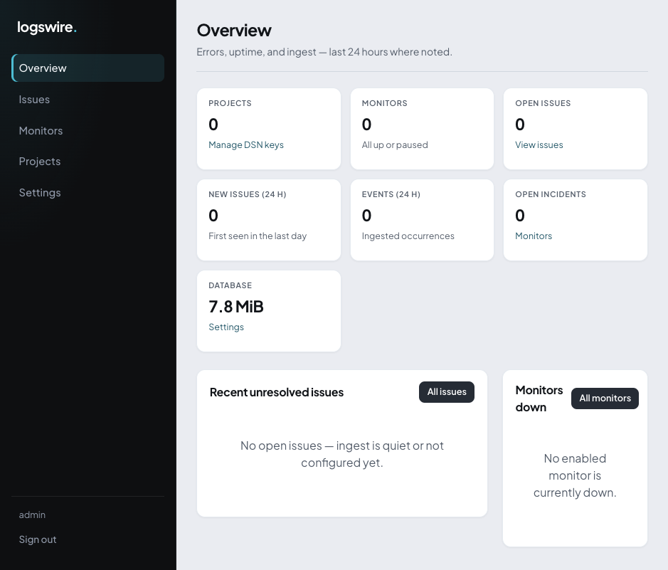

# Logswire



A self-hosted, Sentry-compatible error tracker with uptime monitors. Drop-in
replacement for the Sentry ingest endpoint, with a Twig dashboard and Telegram
alerts for both errors and HTTP checks.

Runs with **Docker Compose**: **PostgreSQL 16** plus the Logswire app on FrankenPHP. No external services, no SaaS.

**In scope:** Sentry SDK errors/events, issue grouping, Telegram on first occurrence, HTTP uptime monitors (status, latency, incidents), Twig UI.  
**Out of scope:** OpenTelemetry, APM.  
**UI language:** English only — no translation layer.

Screens: [overview](docs/screenshots/overview.png) · [issues](docs/screenshots/issues.png) · [monitors](docs/screenshots/monitors.png) · [monitor detail](docs/screenshots/monitor-detail.png).

## Requirements

- Docker 24+ with Compose v2
- A reachable host:port (default: `:8080`)
- ~1.5 GB RAM available for the full Compose stack (Postgres, app, worker, probe)
- ~250 MB for the image, plus disk for the database and backups

## Install

```bash
cp .env.example .env
```

Edit `.env`:

- `APP_SECRET` — generate one with `openssl rand -hex 32`
- `APP_PUBLIC_URL` — public URL (e.g. `https://logswire.example.com`)
- `POSTGRES_PASSWORD` — pick a strong password before exposing the host
- `APP_HTTP_PORT` — host port published by Docker (default `8080`; change it,
  and `APP_PUBLIC_URL` with it, if the port is already taken)

```bash
docker compose up -d --build
curl http://localhost:8080/healthz
# {"status":"ok","db":"up"}
```

Migrations run automatically when the app container starts. The `postgres`
data lives in the `logswire-pgdata` named volume, so `docker compose down`
keeps it (`down -v` deletes it).

Create admin (no web signup):

```bash
docker compose exec logswire bin/console app:owner:create admin --password='choose-one' --admin
```

Log in at `http://localhost:8080/` — you land on **Overview** (projects, monitors,
issues, 24 h ingest). Create a project, copy the DSN from **Projects**.

Security (proxy, DSN, NPM): [`SECURITY.md`](SECURITY.md).

Smoke test: `./scripts/smoke-sentry.sh` (see [`CONTRIBUTING.md`](CONTRIBUTING.md)).

### Prebuilt image (no clone)

Multi-arch images (`linux/amd64`, `linux/arm64`) are published to GitHub
Container Registry by CI on every push to `main` and every `v*` tag:

```bash
docker pull ghcr.io/creasitenet/logswire:latest
```

With `compose.yaml` and `.env` at hand, run the published image instead of
building locally:

```bash
LOGSWIRE_IMAGE=ghcr.io/creasitenet/logswire:latest docker compose up -d --no-build
```

On `main` CI publishes `latest`, `main` and `sha-<short>`. Pushing a `v*` tag
adds the matching semver tags (`1.0.0`, `1.0`, `1`). If the GHCR package is
still private, log in first with `docker login ghcr.io`.

## Point a Sentry SDK at Logswire

DSN shape:

```text
http://<public_key>@<host>:8080/<project-slug>
```

```python
import sentry_sdk
sentry_sdk.init(dsn="http://<public_key>@localhost:8080/<slug>")
```

The DSN ends with the project slug: SDKs append `/api/<project-slug>/envelope/`
themselves. Browser SDKs only enforce a *numeric* project id in debug builds, so
keep `__SENTRY_DEBUG__` disabled (the default in production bundles).

HTTP ingest details: [`docs/INGEST.md`](docs/INGEST.md).

No SDK wired yet? `./scripts/demo-traffic.sh --dsn '<dsn>'` pushes realistic
grouped demo events (PHP/browser exceptions, tags, releases, `--loop` mode).

## Optional: Telegram alerts

Set `LOGSWIRE_TELEGRAM_BOT_TOKEN` and `LOGSWIRE_TELEGRAM_CHAT_ID` in `.env`, restart. One message per **new** issue (not per repeat). Test from **Settings → Send test message**.

Resolved issues reopen automatically when a new event arrives. Set `LOGSWIRE_TELEGRAM_RENOTIFY_REOPENED=1` to also send an alert on that transition (disabled by default).

The same credentials power uptime alerts: `[uptime] DOWN` and `[uptime] RECOVERED` are sent on status transitions only.

## Uptime monitors

Add monitors from **Monitors** in the dashboard (`http(s)` URLs only, interval
≥ 60 s). The list shows a 24-bar sparkline (height = latency, red = down) and
the 24 h uptime; the detail page has a 24 h / 7 d / 30 d range switch, uptime
bars, a latency chart and the incident history. All charts are server-rendered
SVG — no chart library, no extra JS.

Checks are aggregated on write: **no raw check is stored.** Each probe updates
one hourly and one daily bucket (`LOGSWIRE_UPTIME_HOUR_RETENTION_DAYS` / `LOGSWIRE_UPTIME_RETENTION_DAYS`),
so 60 probes at a 60 s interval become a single hourly row. Uptime is always
`up_count / probe_count`; gaps with no probes are drawn as empty, never as 0 %.
Day buckets are aligned on **UTC midnight** and every timestamp is displayed in
UTC, so what you read in the dashboard matches the database and your logs.
A monitor flips to `DOWN` after **2 consecutive failures**, so a single blip
does not open an incident.

Checks run in a dedicated `probe` container so a busy web process never delays
them:

```bash
docker compose ps
docker compose logs -f probe
```

The probe reuses the web image (`logswire:prod`) with `LOGSWIRE_ROLE=probe`,
which skips migrations and FrankenPHP, then runs `app:probe:loop`. It waits for
the web container to be healthy, so the schema is always migrated first.

Tuning (`.env`, restart required):

| Variable | Default | Purpose |
|----------|---------|---------|
| `LOGSWIRE_UPTIME_TICK_SECONDS` | `10` | Scheduler wake-up interval |
| `LOGSWIRE_UPTIME_PROBE_BATCH` | `20` | Max monitors probed per tick |
| `LOGSWIRE_UPTIME_HTTP_TIMEOUT_MS` | `5000` | Per-request timeout |
| `LOGSWIRE_UPTIME_RETRY_COUNT` | `2` | Retries within a single cycle |
| `LOGSWIRE_UPTIME_RETRY_DELAY_SECONDS` | `1` | Delay between retries |
| `LOGSWIRE_UPTIME_HOUR_RETENTION_DAYS` | `10` | Hourly buckets kept |
| `LOGSWIRE_UPTIME_RETENTION_DAYS` | `90` | Daily buckets + incidents kept |

A monitor that goes DOWN is re-checked every `interval × 2` (minimum 120 s) to
avoid hammering a dead host.

## Behind a reverse proxy

Set `TRUSTED_PROXIES` and `APP_PUBLIC_URL` to your public HTTPS URL.

**Case 1 — proxy on the host** (Caddy on the VPS, not in Docker): forward to the
published port, e.g. `127.0.0.1:${APP_HTTP_PORT}`.

```caddy
logswire.example.com {
    reverse_proxy localhost:8080
}
```

**Case 2 — NPM (or similar) in Docker on a shared network** (several stacks on one
machine): in `compose.yaml`, uncomment `proxy-tier` under `networks:` and on
service `logswire`, then recreate the stack. In NPM set Forward Hostname to
`logswire`, port `8080` (not the host-mapped port). The external network name
(`proxy-tier`, `web`, …) is yours — adjust `name:` in the compose comment. Postgres
and `probe` stay on `logswire-net` only.

## Backups

```bash
docker compose exec logswire bin/console app:db:backup
docker compose exec logswire bin/console app:db:restore /app/var/backups/logswire-YYYYmmdd-HHMMSS.sql --force
```

`app:db:backup` runs `pg_dump` (plain SQL, `--clean --if-exists --no-owner`)
against the same connection as the app and writes to `./var/backups/` by
default (`--output/-o` to change). Restore drops and recreates the schema, so
stop `logswire`, `probe` and `worker` first. Copy dumps off the host: the Postgres data
itself lives in a Docker volume, not in `./var/data/`.

Without the container, plain Postgres tools work too:

```bash
pg_dump --clean --if-exists --no-owner "$DATABASE_URL" > logswire.sql
psql "$DATABASE_URL" -f logswire.sql
```

## Maintenance & database size

**Retention is automatic** (default `LOGSWIRE_RETENTION_DAYS=15`): the **`worker`**
service runs Symfony Scheduler + Messenger — error retention prune once per day (throttled,
state in `logswire-runtime` at `/data/.retention_last_run`), uptime retention prune
hourly. Telegram alerts are queued on the same worker (not on the ingest or probe
path). No host cron.

If the **`worker` service is stopped**, automatic retention prunes and outbound alerts queue
up (or stall) until it is back. Uptime **checks** still run when only `probe` is up;
ingest and the UI keep working. Manual error prune:
`docker compose exec logswire bin/console app:retention:cleanup`.

```bash
docker compose logs -f worker
```

- Tune: `LOGSWIRE_RETENTION_DAYS` in `.env`, restart.
- Force prune: `docker compose exec logswire bin/console app:retention:cleanup`
- **Overview** (`/dashboard`): headline counts and recent issues (cheap queries).
- **Settings** (admin): retention status, Telegram test, payload-based capacity projection.

Steady-state sizing (typical PHP error, ~4–5 KiB per occurrence with full payload today):

```text
rows kept    ≈  occurrences per day × LOGSWIRE_RETENTION_DAYS
disk usage   ≈  rows × ~4–5 KiB  (plus indexes, ~×1.5)
```

| Occurrences / day | ~15 days retention |
|--------------------|--------------------|
| 20 | ~2 MiB |
| 200 | ~20 MiB |
| 2 000 | ~200 MiB |

Comfort zone: **tens to low hundreds of MiB**. Postgres handles multi-GB data
fine, but backups and issue detail load get heavier — shorten retention or trim
SDK context first.

## Architecture

```text
Sentry SDK → POST /api/{slug}/envelope/ → IngestService → PostgreSQL (issues + events)
                                              ↓
                              Messenger (notifications queue)
Twig UI ← Overview, IssueService, MonitorPresenter

app:probe:loop → HTTP probes → PostgreSQL (metric buckets + incidents, aggregated per tick)
              ↓
   Messenger (monitor alerts)

worker: messenger:consume + Scheduler → error/uptime retention prune, Telegram send
```

Symfony layout: `Controller/`, `Service/<feature>/`, `Repository/`, `Entity/`. See [`CONTRIBUTING.md`](CONTRIBUTING.md).

### Database schema

| Environment | How the schema is created |
|-------------|---------------------------|
| **Docker / PostgreSQL** | Doctrine migrations on container start (`doctrine:migrations:migrate`) |
| **PHPUnit** | Doctrine `SchemaTool` from `src/Entity/` (file-backed SQLite — migrations are not run) |

When you change an entity, update the entity **and** the initial migration (or add a new migration) before shipping. `doctrine:schema:validate` against Postgres catches drift.

### Console commands

Run inside the app container unless you have `DATABASE_URL` locally:

```bash
docker compose exec logswire bin/console <command>
```

| Command | Purpose |
|---------|---------|
| `app:owner:create` | First admin user (required once; no web signup) |
| `app:user:password` | Reset a local user's password |
| `app:project:create` | Create a project and print DSN parts (smoke / ops) |
| `app:db:backup` | `pg_dump` to `./var/backups/` |
| `app:db:restore` | Restore a dump (`--force` after stopping app, probe and worker) |
| `app:retention:cleanup` | Delete events/issues past `LOGSWIRE_RETENTION_DAYS` |
| `app:probe:loop` | HTTP probe scheduler (used by the `probe` Compose service, not the web container) |

List everything: `bin/console list app`.

## Updating

```bash
git pull
docker compose up -d --build
```

This rebuilds the **logswire**, **probe** and **worker** images (same Dockerfile, different `LOGSWIRE_ROLE` / command). Postgres keeps its data in the `logswire-pgdata` volume. After a UI-heavy release, refresh [`docs/screenshots/`](docs/screenshots/) if the README hero looks stale (see [`CONTRIBUTING.md`](CONTRIBUTING.md)).

## Roadmap

[`ROADMAP.md`](ROADMAP.md) — planned features after the first public release
(notifications, background jobs, UI polish). Not a commitment on dates.

## Contributing

[`CONTRIBUTING.md`](CONTRIBUTING.md)

## License

MIT. Vendored frontend assets keep their upstream licenses:
[`public/js/htmx.LICENSE`](public/js/htmx.LICENSE) (Zero-Clause BSD) and
[`public/fonts/LICENSE`](public/fonts/LICENSE) (SIL OFL 1.1).
